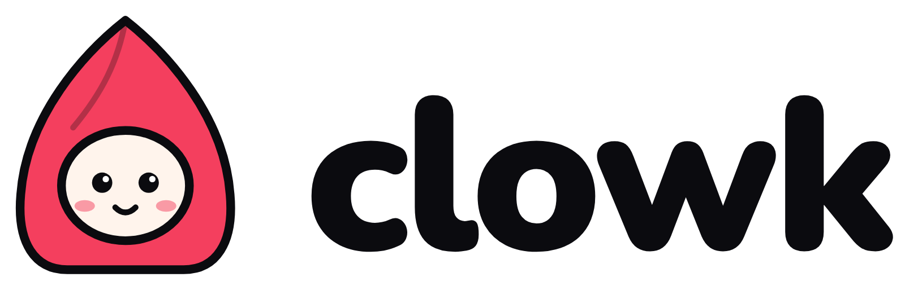
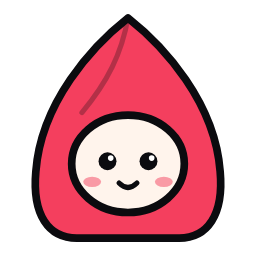

# Clowk brand

<p>
  
</p>

This folder holds the Clowk visual identity: the mark, the wordmark, the lockups, the app icons, the colors and the tools that build them. Use these files. Do not draw the mark again.

Clowk is the family name. ndb, Voodu, Anway and Cronota keep their own marks, and they sit next to Clowk as "by Clowk".

## The mark: Hood

<p>
  
</p>

The name sounds like "cloak", so the mark is a small figure in a coral hood. It has the same drawing language as the rest of the family (the ndb bowl, the Cronota note): a dark outline, flat fills, and a friendly face.

### Construction

The mark is built on a 200 unit grid. `tools/build.py` holds every value.

| Part | Rule |
|---|---|
| Hood | A drop shape from the tip at (100, 14) down to a flat bottom at y 186, x 28 to 172. Fill coral `#F43F5E`, outline 6 units of ink `#0B0B0F`, round joins. |
| Fold | One curve from the tip down the left side, 4 units of ink at 28% opacity. |
| Face | An ellipse at (100, 128), 44 by 38, fill cream `#FFF4EC`, outline 6 units. |
| Eyes | Two ink dots of radius 7 at x 84 and 116, each with a white highlight of radius 2.2. |
| Cheeks | Two coral ellipses, 7 by 4, at 50% opacity. |
| Smile | A small curve of 4 units, round ends. |

### Small drawings

At 32 px and below, use the small drawing (`mark-small-*`, `favicon.svg`): a heavier outline of 14 units, a bigger face, bigger eyes, and no fold, cheeks or smile.

At 16 px, the favicon tile uses the tiny drawing: flat coral hood, cream face and two ink eyes, with no outline at all.

### Dark surfaces

The mark keeps its coral hood and its ink outline on dark surfaces. The on-dark files (`mark-on-dark`, `mark-small-on-dark`, `lockup-*-on-dark`, the night app icon) add a white halo of 6 units around the hood, so the edge does not vanish. Do not turn the hood dark.

### One color

`mark-ink` and `mark-white` are for one-color uses (print, stamps, embroidery): the hood with the face cut out and the eyes inside the cut.

## Wordmark

The wordmark is `clowk` in lowercase, Nunito Black, tracking -0.03 em. The letters are outlined into SVG paths by `tools/outline_wordmark.py`, so no file needs the font.

## Colors

| Name | Hex | Use |
|---|---|---|
| Coral | `#F43F5E` | The hood, the primary action |
| Ink | `#0B0B0F` | Outlines, the wordmark on light |
| Night | `#0C0014` | Dark surfaces, the night app icon |
| Cream | `#FFF4EC` | The face |
| Muted | `#C9C3D4` | Secondary text on night |

## Files

| File | Use |
|---|---|
| `svg/mark-on-light.svg`, `svg/mark-on-dark.svg` | The mark, 33 px and up |
| `svg/mark-small-on-*.svg`, `svg/favicon.svg` | The mark, 32 px and below |
| `svg/mark-ink.svg`, `svg/mark-white.svg` | One color |
| `svg/wordmark-on-*.svg` | The wordmark alone |
| `svg/lockup-on-*.svg` | Mark and wordmark in a row: headers, footers |
| `svg/lockup-stacked-on-*.svg` | Mark above the wordmark: splash screens, square spaces |
| `svg/app-icon-night.svg`, `-coral`, `-light` | App icons with rounded corners |
| `svg/app-icon-square.svg` | Square icon for PWA and Apple touch icons |
| `svg/favicon-tile.svg`, `favicon.ico` | Browser tabs |
| `svg/social-preview.svg` | Open Graph and social cards, 1200 × 630 |
| `png/` | PNG renders of all of the above |

## Build

```bash
python3 brand/tools/build.py      # SVG files from the rules above
node brand/tools/render.mjs       # PNG files and favicon.ico (needs Playwright)
```

Run `tools/outline_wordmark.py` only when a text changes. Its header says how.
