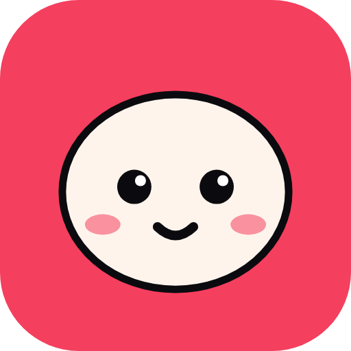

# Clowk brand

<p>
  
</p>

This folder holds the Clowk visual identity: the mark, the wordmark, the lockups, the app icons, the colors and the tools that build them. Use these files. Do not draw the mark again.

Clowk is the family name. ndb, voodu, anway and cronota keep their own marks, and they sit next to Clowk as "by Clowk".

## The mark: the face

<p>
  
  
</p>

The name sounds like "cloak". The mark is the face of the small figure inside the coral hood. It has the same drawing language as the rest of the family (the ndb bowl, the cronota note): a dark outline, flat fills, and a friendly face.

Use it in two forms:

- **The face** next to the wordmark: headers, footers, the lockups.
- **The tile**: the face on a coral square. The coral is the hood. Use it where the mark stands alone: favicons, app icons, the home screen, avatars, the social preview.

### Construction

The face is drawn around (0, 0). `tools/build.py` holds every value.

| Part | Rule |
|---|---|
| Face | An ellipse of 172 × 148 units, fill cream `#FFF4EC`, outline 5.7 units of ink `#0B0B0F`. |
| Eyes | Two ink dots of radius 13 at x ±31.3, each with a white highlight of radius 4.2. |
| Cheeks | Two coral ellipses, 27 × 15.6, at 55% opacity. |
| Smile | A small curve of 7.3 units, round ends. |
| Tile | A coral `#F43F5E` square. The face covers 64.5% of its width, a little below the middle (54.7% of the height). Corner radius 22.5% of the side; none for the home screen icon, which iOS rounds. |

### Small drawings

At 32 px and below, use the small face (`mark-small-*`, `favicon.svg`): a heavier outline, bigger eyes, no highlights. At 16 px the favicon tile uses the tiny face: no outline and no cheeks, so the eyes and the smile stay clear.

### One color

`mark-ink` and `mark-white` are for one-color uses (print, stamps, embroidery): the outline of the face, the eyes and the smile.

### The mascot

The full drawing with the hood (`mascot-on-light`, `mascot-on-dark`) is kept for large illustrations, such as a 404 page. It is not the logo: do not use it in headers, icons or favicons.

## Wordmark

The wordmark is `clowk` in lowercase, Nunito Black, tracking -0.03 em. The letters are outlined into SVG paths by `tools/outline_wordmark.py`, so no file needs the font.

## Colors

| Name | Hex | Use |
|---|---|---|
| Coral | `#F43F5E` | The hood, the primary action |
| Ink | `#0B0B0F` | Outlines, the wordmark on light |
| Night | `#0C0014` | Dark surfaces, the night app icon |
| Cream | `#FFF4EC` | The face |
| Muted | `#C9C3D4` | Secondary text on night |

## Files

| File | Use |
|---|---|
| `svg/mark-on-light.svg`, `svg/mark-on-dark.svg` | The face, 33 px and up |
| `svg/mark-small-on-*.svg` | The face, 32 px and below |
| `svg/mark-ink.svg`, `svg/mark-white.svg` | One color |
| `svg/mark-tile.svg` | The face on the coral tile |
| `svg/wordmark-on-*.svg` | The wordmark alone |
| `svg/lockup-on-*.svg` | Face and wordmark in a row: headers, footers |
| `svg/lockup-stacked-on-*.svg` | Face above the wordmark: splash screens, square spaces |
| `svg/app-icon.svg` | App icon with rounded corners |
| `svg/app-icon-square.svg` | The home screen icon (iOS, PWA), full bleed |
| `svg/favicon.svg`, `svg/favicon-tile.svg`, `favicon.ico` | Browser tabs |
| `svg/mascot-on-*.svg` | The full hood drawing, for large illustrations only |
| `svg/social-preview.svg` | Open Graph and social cards, 1200 × 630 |
| `png/` | PNG renders of all of the above |

## Build

```bash
python3 brand/tools/build.py      # SVG files from the rules above
node brand/tools/render.mjs       # PNG files and favicon.ico (needs Playwright)
```

Run `tools/outline_wordmark.py` only when a text changes. Its header says how.
